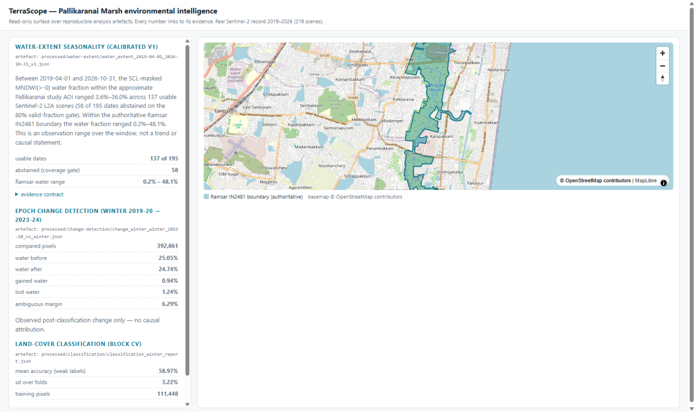
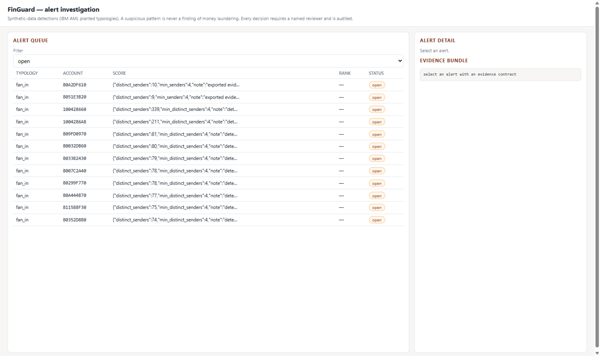
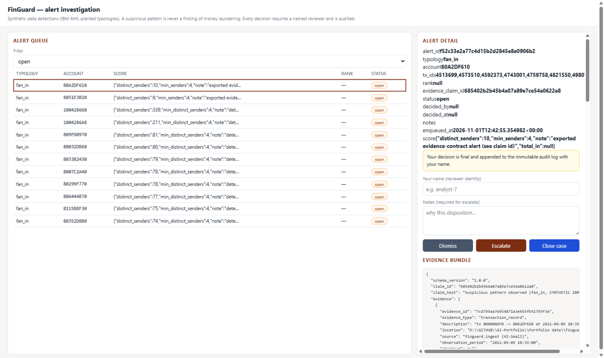

# TerraScope & FinGuard — AI systems that show their evidence

[](https://github.com/Thunderz-z/AI-fintech-geospatial-project/actions/workflows/ci.yml)


Two working intelligence systems, one shared foundation. **TerraScope** reads seven years of
Sentinel-2 satellite imagery over a protected wetland and turns it into calibrated, quantified
environmental findings. **FinGuard** reconstructs transaction networks, surfaces money-laundering
typologies, and routes them into an audited human-review workflow. Both are bound by **RELIA**, an
in-house reliability layer that makes every generated claim machine-checkable: each number ships
with its evidence, methodology, uncertainty — or the system openly abstains.

The through-line is simple: an AI system that can't show *why* it claims something isn't finished.
Here, every headline number below traces to a checksummed artefact, a versioned configuration and
a one-line command that reproduces it.

## TerraScope — environmental intelligence for the Pallikaranai Marsh

Pallikaranai is a Ramsar-listed freshwater marsh in Chennai, India — and one of the last of its
kind. TerraScope measures what is happening to its water, season by season, from space.

The pipeline ingests the **full Sentinel-2 Level-2A record — 219 scenes spanning April 2019 to
October 2026** — through AOI-bounded Cloud-Optimized-GeoTIFF windows (never full scenes), masks
clouds with the ESA scene classification, and composites each season onto a fixed 20 m grid. The
MNDWI water index is **calibrated against ESA WorldCover reference data (Cohen's κ = 0.45)**, and
every date that fails the 80% cloud-free gate is *abstained* rather than guessed — 58 of 195
dates. The study boundary is the **official Ramsar IN2481 polygon**, verified against the
declared area to within 0.06%.

What that buys: a 7.5-year water-extent series with a **statistically robust monsoon signal
(+9.1 percentage points NE-monsoon over dry season, bootstrap 95% CI [4.0, 14.9])** — with the
three wettest observations landing exactly on the December 2021 Chennai floods. Epoch change
detection compares winters 2019-20 and 2023-24 pixel-by-pixel across 392,861 cells with an
accompanying uncertainty surface, and a random-forest land-cover classifier is validated with
spatial block cross-validation so the accuracy numbers mean what they say.

## FinGuard — anti-money-laundering analytics with a paper trail

FinGuard works the other domain with the same discipline. On the IBM AML synthetic corpus
(5.08 M transactions), it builds leakage-safe temporal features, trains an imbalance-aware
LightGBM detector (**92% precision at a 0.1% alert budget — 15.6× the base fraud rate**), and
runs vectorized detectors for four laundering typologies on the transaction graph: fan-in,
fan-out, cycles and structuring, plus scatter-gather and rapid-movement chains.

Raw graph alerts drown analysts — the unranked fan-in detector flagged legitimate convergence
traffic almost exclusively. So FinGuard ranks: a LightGBM ranker trained strictly on
pre-test-period alerts lifts **precision on target attempts from 0.0 to 0.667 at the same alert
budget**. Every surviving alert becomes a RELIA evidence bundle — transaction-level references,
detector parameters, model provenance — and lands in an **investigation queue where a named
human makes the only consequential decisions**, with every disposition written to an
append-only audit log. The system detects patterns; it never declares crimes.

## RELIA — the reliability layer both systems stand on

RELIA is what makes the two applications defensible. Typed **evidence contracts** enforce the
invariants that matter (a valid claim must cite evidence; an abstention must state its reason).
A provider abstraction with retry/timeout/backoff and a cost ledger fronts hosted LLMs behind
record/replay cassettes, so evaluation and tests run offline and deterministically. The
evaluation engine separates deterministic checks from model-judged scoring, and — the piece
built for real maintenance — **regression bisection**: when a prompt or config change degrades
behaviour, RELIA walks the version history with paired bootstrap confidence intervals and names
the change that broke it.

## Screenshots

**TerraScope** — the authoritative Ramsar boundary on a live map, with the calibrated water
series, epoch change detection and block-CV classification cards:



**FinGuard** — the ranked investigation queue and an alert's evidence bundle:





## Measured results (all reproducible)

| Result | Value | Reproduce from |
|---|---|---|
| Sentinel-2 record analysed | 219 scenes, 2019-04 → 2026-10, 2.34 GB | `data/manifests/terrascope-manifest.yaml` |
| Water seasonality (7.5 years) | Δ +9.1 pp, 95% CI [4.0, 14.9] | `scripts/seasonality_analysis.py` |
| Dates usable / abstained | 137 / 58 (80% coverage gate) | `processed/water-extent/*_v1.json` |
| Epoch change (winter) | 25.05% → 24.74% water; ±~1% transitions | `scripts/run_change_detection.py` |
| Land-cover agreement (block CV) | 58.97% ± 3.22% vs ESA reference labels | `scripts/run_classification.py` |
| Fraud detection (synthetic) | PR-AUC 15.6× base rate; 92% precision @ 0.1% budget | `scripts/run_fraud_baseline.py` |
| Alert ranking impact | precision on target attempts 0.0 → 0.667 @ 0.1% budget | `scripts/evaluate_alert_ranking.py` |
| Test suite | 335 tests green; ruff + mypy clean | `uv run pytest` |

## Architecture

```
                 ┌──────────────────────────────┐
                 │  RELIA (packages/relia)      │
                 │  contracts · providers ·     │
                 │  replay · prompts ·          │
                 │  evaluations · regression ·  │
                 │  tracing · observability     │
                 └──────────┬───────────────────┘
                            │ evidence contracts,
                            │ provider + eval interfaces
              ┌─────────────┴─────────────┐
   ┌──────────┴──────────┐     ┌──────────┴──────────┐
   │ TerraScope          │     │ FinGuard            │
   │ satellite imagery → │     │ transactions →      │
   │ indices → classify →│     │ features → model →  │
   │ change → evidence → │     │ graph motifs →      │
   │ API + map           │     │ queue → API         │
   └─────────────────────┘     └─────────────────────┘
```

Seven architecture decision records under [`docs/decisions/`](docs/decisions/) capture the
reasoning: the uv-workspace monorepo, the evidence-contract schema, the external data-root
contract, staged dependencies, the spatial-block/temporal validation methodology, and the
no-local-Docker setup with CI-built images.

## Run it

```powershell
git clone https://github.com/Thunderz-z/AI-fintech-geospatial-project
cd AI-fintech-geospatial-project
uv sync                          # Python 3.13 environment from uv.lock
uv run pytest                    # 335 tests, offline
uv run uvicorn terrascope.api.app:app --port 8801   # map UI at http://127.0.0.1:8801
uv run uvicorn finguard.api.app:app  --port 8802    # investigation UI at http://127.0.0.1:8802
```

Both UIs are served by the APIs themselves — no build step. FinGuard's demo queue seeds from
the exported evidence bundles (`projects/finguard/scripts/seed_investigation_queue.py`).
Datasets resolve exclusively through the `PORTFOLIO_DATA_ROOT` environment variable — the
documented acquisition path, manifests and licence terms live in
[`data/manifests/`](data/manifests/), and every artefact the numbers above come from sits under
that root, outside the repository.

## Known limitations 

- FinGuard's fan-out/cycle alerts are not yet ranked (only fan-in is); structuring and
  rapid-movement are validated on synthetic fixtures only (no planted ground truth in HI/LI-Small)
- TerraScope's absolute water levels depend on the calibrated MNDWI threshold (stated in every
  contract); the classification measures weak-label agreement, not map accuracy
